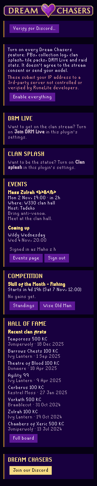
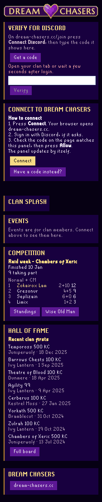

# Dream Chasers Clan (RuneLite plugin)

The Dream Chasers clan's own RuneLite plugin. It adds a sidebar panel with:

- **Events**: the next clan event (with a countdown, or LIVE) and what's coming
  up. Events are for clan members only, so this needs a one-time sign-in (below).
- **Competition**: the clan's current Wise Old Man competition and its top 10.
- **Hall of Fame**: the most recent clan firsts.
- **Links**: the clan site, and "Join our Discord" once the clan has a permanent invite.

Everything comes from the clan site, `https://dream-chasers.cc`.
Two opt-in extras sit in the same panel: **DRM Live** (get on the clan stream)
and the **Clan splash** (be the featured member's statue). Further opt-ins post
your own personal bests and new collection log slots to the clan's Hall of Fame,
share your raid stats while you're on DRM Live, and copy the clan's tile packs.

 

(Rendered headless by `DreamChasersPanelTest` from the test fixtures; the test writes fresh copies to `build/`.)

## Settings

Every setting below that talks to dream-chasers.cc is off until you turn it on.
RuneLite shows them in five sections: Connect, Appearance, Data, PvM and
Livestream.
Sign in first: follow the panel's **Join Dream Chasers** steps (join the
Discord, then **Verify in browser** in **Verify for Discord**). Pressing
step 1 or 2 turns on **Connect to dream-chasers.cc**, the first setting. Once
you're signed in, the panel
offers **Enable everything** (with the IP-address warning next to it), and the
second setting does the same. It switches on Post personal bests, Post
collection log, Clan splash, Clan tile packs, Join DRM Live and Share raid
stats. Before you're signed in it does nothing: the setting unticks itself and
the join card says why. It
never agrees to the DRM Live stream consent or sends your character's model;
those stay their own buttons. Untick it to turn them all off again. Turn one
feature off by hand and it unticks itself, leaving the others as they are;
turn all of them on by hand and it ticks itself. RuneLite's settings show these
changes once you close and reopen them.

- **Connect to dream-chasers.cc** (off by default). Nothing is fetched until you
  turn this on, or press step 1 or 2 on the panel's join card (the same
  switch). As with every plugin that talks to a server outside RuneLite, this
  sends your IP address to that server (dream-chasers.cc). It also turns on
  **Verify for Discord** (below), which reads only your own clan record.
- **Officer roster sync** (off by default, officers only). When you close the
  clan **Members** screen in game, the plugin sends the clan's member list
  (names and rank titles, nothing else) to dream-chasers.cc, which updates the
  clan's Wise Old Man group. It also verifies newcomers who say their witness
  code in clan chat or PM it to you. See Officer roster sync (below). Same
  IP-address warning. **Enable everything** leaves it alone.
- **Join DRM Live** (off by default). Shows the DRM Live section (below). Same
  IP-address warning.
- **Clan splash** (off by default). Shows the **Feature me on the clan
  splash** button (below). Same IP-address warning.
- **Post personal bests** (off by default). When the game tells you a boss,
  raid or Sailing Barracuda Trial time ("Fight duration: … (new personal best)", raid completion times),
  the plugin sends it to the clan's Hall of Fame: boss, time, kill count, team
  size where the game gives it, your RSN and your hashed account id (see
  Verify for Discord). The PBs RuneLite already knows
  (its !pb store) are sent too, at most once a day (again if you switch accounts that day) and only when they've changed, so you don't have to re-kill every boss. Only your own kills, and only
  while you're connected. Same IP-address warning.
- **Post collection log** (off by default). Each new collection log slot goes
  to the clan's Hall of Fame, with where it came from, your RSN and your hashed
  account id. Turn on the game's own
  setting **Collection log - New addition notification** (Settings, Chat; chat,
  popup or both); the panel tells you if it's off. Your own drops worth the clan's big-drop amount (10M today, never below 1M; the same for
  everyone, set by the site) are posted too, priced with RuneLite's own item
  prices (no extra downloads). PvP kills are never posted. Same IP-address warning.
- **Share raid stats on DRM Live** (off by default). While you're on the clan
  stream and inside Chambers of Xeric, Theatre of Blood or Tombs of Amascut,
  the plugin sends your own hitpoints, prayer and inventory to dream-chasers.cc
  at most every 5 seconds, for a small box on your stream tile. Nothing about
  other players. It needs the stream consent, and the site keeps nothing. Same
  IP-address warning.
- **Clan tile packs** (off by default). Lists the clan's ground-marker packs
  (published by officers) with a **Copy** button. Copy a pack, then in game
  right-click the world map orb and use RuneLite's own Ground Markers
  **Import**. The plugin only uses the clipboard; it never changes Ground
  Markers' settings itself. Same IP-address warning.
- **Show sidebar button**.

The clan's PB and loot feeds live on the site
([dream-chasers.cc/hall-of-fame](https://dream-chasers.cc/hall-of-fame)), not
inside RuneLite.

## Verify for Discord

The new way to link the plugin, and the way the clan's Discord gives you the
**Verified** role. It needs **Connect to dream-chasers.cc** on (off by default,
with the IP-address warning) and works only when your own clan record in game
says the clan's in-game name, DRM Chasers.

1. In the panel's **Verify for Discord** box press **Verify in browser**.
   If the button is greyed out the box says why: "Log in to the game to
   verify", "Join the clan in game first", "Your clan in game isn't DRM
   Chasers. Join DRM Chasers first", or "Join DRM Chasers in game first, or
   open your clan tab and wait a few seconds".
2. Your browser opens a dream-chasers.cc page (sign in with Discord if it
   asks). It says "Link game account **your RSN** (DRM Chasers) to your
   Discord **a name**?". Only press **Approve** if you pressed Verify in your
   own RuneLite just now; if someone sent you the link, press **Deny**. On a
   different network from the PC the page also asks for the 4-character code
   the panel shows.
3. The panel picks up the answer by itself: it is signed in, and the Verified
   role arrives in Discord within about a minute once you're in the server.
   If your name isn't on the clan roster yet, or an officer has to check, the
   panel says so and dream-chasers.cc/join tells you what's next.

Have a code from dream-chasers.cc/join instead? **Have a code from the site?**
under the button opens the code field: type it, press **Verify**, check the
Discord name the panel shows, then **Confirm**.

Already signed in? **Verify for Discord…** is folded at the top of the panel;
run it once to get the Verified role and protect your name.

**What the plugin reads:** only your own clan record: the clan's name and
whether you're in it. Never the member list, never anyone else.

**What it sends** (to dream-chasers.cc, and only when you press the buttons):
the code; your RSN; the clan's name as the game shows it; the plugin's version;
"RuneLite" as the device name; and a **hashed account id**: a one-way SHA-256
of `"drm-clan-v1|"` and RuneLite's account hash. The account hash itself never
leaves your PC, and the site can't turn the hashed id back into it. It stops
someone else taking your name. Your clan rank and join date are not sent.
With posting turned on, your PBs, old PBs, collection log slots and big drops
carry the same hashed account id, so the site can tell they come from the
account that verified.

## Officer roster sync

For officers (Summoner, Illusionist, Wizard, Warlock, Necromancer and up). With
**Officer roster sync** on and the panel signed in, closing the clan
**Members** screen (Clan settings, Members: where you rank someone up) sends
the clan's member list to dream-chasers.cc, and the site updates the Wise Old
Man group. A rank-up to Gnome Child reaches the site within seconds, with no
extra button. This is the same list the Wise Old Man plugin's own group sync
reads.

- **What it sends:** each member's name and rank title, the clan's name as the
  game shows it, and your own RSN. Never locations, gear or stats.
- **When:** a moment after you close the Members screen, and only when the list
  has changed since the site last took it. At most once a minute: a change
  inside the minute is sent by itself once the minute is up, and the panel
  says when ("Changed again: sending at 12:35"). If the site was busy or
  couldn't be reached, the same list goes once more a minute later.
- The panel shows one line, like "Roster sent 12:34: 2 added, 1 rank changed".
  If the site says you're not an officer, the sync stops until you log in
  again or tick the setting again, and the panel says why.

### Verify pickup

The same setting verifies newcomers for you. A member on mobile gets a witness
code at dream-chasers.cc/join and says it in clan chat, or PMs it to you. The
plugin sends that code and the sender's name (which the game sets, so it
proves the account) to the site, and the site verifies them. Nobody types
anything. The panel shows "Verified Bob 12:34", or says when a request needs
an officer to look at it on the site (a new Discord account, a disputed name,
an officer-rank name and a few others).

- **What it reads:** clan chat and the PMs you receive. Only a line holding a
  code (`DRM-` and six characters) leaves your PC, and a PM only from someone
  in the clan. Every other line is ignored.
- **What it sends:** the code, the sender's name, whether it was clan chat or
  a PM, and your own RSN. At most 20 in 10 minutes, two codes per sender.
- **Online dot:** while the setting is on, the plugin tells the site every 5
  minutes that an officer's plugin is online, and that it's gone when you log
  out or turn it off. The join page shows newcomers a green dot when saying
  the code will work.

## How to connect (the older way)

The browser-approval flow below still works while the site moves over to
Verify for Discord. In the panel it sits behind **Already verified on another
PC?**.

The first time you open the panel it explains what connecting does: the site
checks your RSN and that you're in the clan's Discord, your IP address goes to
dream-chasers.cc, and it never sees your Jagex or Discord password. Then:

1. Press **Connect**. Your browser opens dream-chasers.cc.
2. Sign in with Discord, if it asks.
3. Check the 4-character code on the page matches the panel, then press **Allow**.

The panel updates by itself within a few seconds. Press **Deny** (or Cancel in
the panel) and nothing is linked. A request lasts 10 minutes.

**Have a code instead?** Get one on dream-chasers.cc/plugin, paste it into the
panel and press **Link**. It works once and lasts 10 minutes.

The plugin only ever stores a token for dream-chasers.cc. **Sign out** in the
panel revokes it, and you can also revoke it on dream-chasers.cc/plugin.

## DRM Live: get on the clan stream

With **Join DRM Live** on and the panel connected, the DRM Live section shows
whether a show is live or open for guests.

1. The first time, it shows the stream consent: your game screen and voice go
   out live and get recorded; share the OSRS window only; never type a bank PIN
   while sharing; you can leave at any time. Press **Agree**. That also gives
   you the On stream role in Discord, so the stream can hear you.
2. Press **Join the stream**. You get your own guest slot, and you wait in the
   queue until a producer puts you on air.
3. **Open my stream link** opens your personal VDO.Ninja link in the browser.
   Press Start and pick the RuneLite window only. Don't share system audio.
4. **Join the stream voice channel** opens Discord at the stream's voice
   channel. Talk there, not in the browser.
5. **Leave** frees your slot. **Withdraw consent** also removes the role.

The plugin only opens links. It never captures or streams the game itself.

## Clan splash: be the statue

Once connected, the panel shows today's featured member: their character as the
dragonstone statue holding the Compass and Heart, with "Featured: <name>". A new
member is picked once a day from everyone who opted in.

To put yourself in, turn on **Clan splash**, then:

1. Read the note in the panel: your character's 3D shape, gear included, goes
   to dream-chasers.cc, and it's shown to the clan with your RSN, in the panel,
   on the site and maybe on the DRM Live stream. The same model is also your
   profile picture and 3D view on your clan profile on the site.
2. Stand still in game (not walking or emoting) and press **Feature me on the
   clan splash**. If you're moving it says "Stand still and try again". Take
   off your weapon and shield first: your character holds the heart in both
   hands.
3. Your splash is made within about an hour. If the splash maker can't use the
   pose, the panel says why; stand still and press **Send a new pose**. You can
   send one every 10 minutes.

**Remove me** takes you out at any time, and the site deletes your model and
splash, and your profile stops using it. The plugin sends only your own character's shape, and only when you
press the button.

## Development

Needs JDK 11. Gradle comes with the wrapper.

```
gradlew.bat build        # compile + tests
gradlew.bat run          # RuneLite dev client with this plugin loaded
gradlew.bat run -PdrmclanApi=https://staging.dream-chasers.cc/api/v1
```

Logging into the dev client with a Jagex account: see
[Using Jagex Accounts](https://github.com/runelite/runelite/wiki/Using-Jagex-Accounts).

## Licence

BSD 2-Clause, see [LICENSE](LICENSE).
